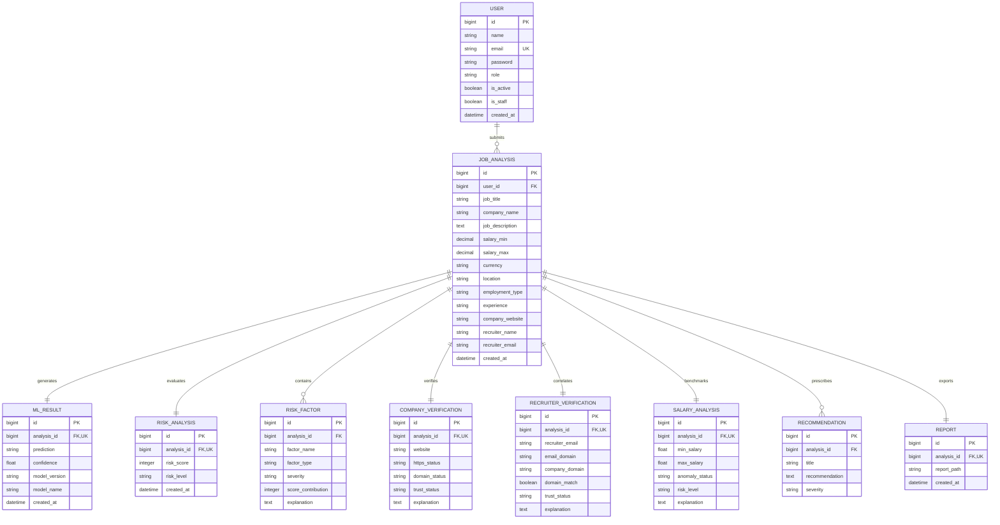

# JobShield AI - Database Architecture & Schema

## 1. Entity Relationship (ER) Diagram

---

## 2. Table Specifications

### `users_user`
- `id` (BigSerial, PK): Unique identifier.
- `name` (Varchar 150): Full user display name.
- `email` (Varchar 254, Unique, Indexed): Primary login handle.
- `password` (Varchar 128): Salted PBKDF2 cryptographic password hash.
- `role` (Varchar 20): Role indicator (`USER` or `ADMIN`).
- `created_at`, `updated_at`: Audit timestamps.

### `analysis_jobanalysis`
- `id` (BigSerial, PK): Unique record identifier.
- `user_id` (BigInt, FK -> `users_user.id`, Nullable): Owning user account.
- `job_title` (Varchar 255, Indexed): Role title.
- `company_name` (Varchar 255, Indexed): Claimed hiring organization.
- `job_description` (Text): Raw posting content.
- `salary_min`, `salary_max` (Numeric 12,2): Optional compensation bounds.
- `currency` (Varchar 10): Default 'USD'.
- `company_website` (Varchar 255): Target verification URL.
- `recruiter_email` (Varchar 255): Target verification contact.
- `created_at` (DateTime, Indexed): Timestamp of analysis submission.

### `analysis_mlresult`
- `analysis_id` (BigInt, One-to-One FK -> `analysis_jobanalysis.id`):
- `prediction` (Varchar 50): Classifier verdict (`Genuine` or `Suspicious`).
- `confidence` (Float): Inference confidence percentage (0.0 - 100.0).
- `model_version` (Varchar 50): Active model iteration tag (e.g., `1.0.0`).
- `model_name` (Varchar 150): Formal name of classification ensemble.

### `analysis_riskanalysis`
- `analysis_id` (BigInt, One-to-One FK -> `analysis_jobanalysis.id`).
- `risk_score` (Integer, Indexed): Aggregate metric bounded from 0 to 100.
- `risk_level` (Varchar 50, Indexed): `Low`, `Moderate`, `High`, or `Critical`.

### `analysis_riskfactor`
- `analysis_id` (BigInt, Foreign Key -> `analysis_jobanalysis.id`).
- `factor_name` (Varchar 255): Concise descriptor (e.g., "Payment Request Detected").
- `factor_type` (Varchar 100): Classification domain (e.g., `PAYMENT_INDICATOR`).
- `severity` (Varchar 20): `LOW`, `MEDIUM`, `HIGH`, `CRITICAL`.
- `score_contribution` (Integer): Positive additive score weight.
- `explanation` (Text): Evidence explanation.

---

## 3. Indexing & Optimization Strategy

1. **Compound Index `(company_name, created_at DESC)`**: Powers rapid chronological company search queries in the history table.
2. **Index on `job_title`**: Enables fast case-insensitive keyword searching across the job portal archive.
3. **Index on `risk_score` and `risk_level`**: Powers instant server-side filtering on the `/history` and `/dashboard` analytics views without full table scans.
4. **Foreign Key Cascades**: Child entities (`MLResult`, `RiskAnalysis`, `RiskFactor`, etc.) are linked with `ON DELETE CASCADE` to ensure strict referential integrity.
